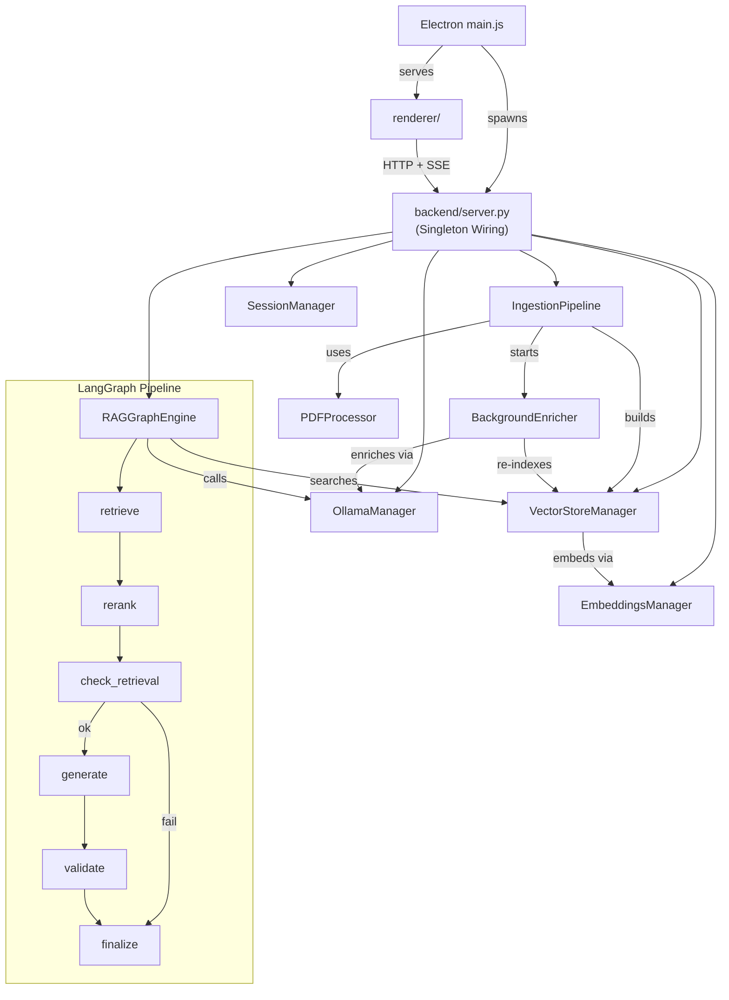

# 🏗️ Architecture

PrivateGPT is a fully air-gapped, local-first document intelligence system. It runs entirely on the user's machine — no cloud services, no telemetry, no external API calls. Every component is designed with this constraint as the primary architectural driver.

---

## High-Level Architecture

```
┌──────────────────────────────────────────────────────────────────────┐
│                     Electron Desktop Frontend                        │
│  ┌──────────┐ ┌──────────┐ ┌──────────┐ ┌──────────┐               │
│  │   Chat   │ │Documents │ │  Models  │ │ History  │               │
│  └────┬─────┘ └────┬─────┘ └────┬─────┘ └────┬─────┘               │
│       │             │            │             │                     │
│  ┌────┴─────────────┴────────────┴─────────────┴────────────────┐   │
│  │    Custom Title Bar + Sidebar Navigation + SPA Routing        │   │
│  └─────────────────────────────┬────────────────────────────────┘   │
│                                │ contextBridge (preload.js)          │
└────────────────────────────────┼────────────────────────────────────┘
                                 │ HTTP + SSE
                    ┌────────────┴────────────┐
                    │   backend/server.py     │
                    │   FastAPI (port 8765)   │
                    │   REST + SSE Streaming  │
                    └────────────┬────────────┘
                                 │
        ┌────────────────────────┼────────────────────────┐
        │                        │                        │
┌───────┴───────┐    ┌──────────┴──────────┐   ┌────────┴────────┐
│  core/ Layer  │    │  config/ Layer      │   │ sessions/ Layer │
│  (Pure Python)│    │  (Settings)         │   │ (Chat History)  │
└───────┬───────┘    └────────────────────┘   └─────────────────┘
        │
   ┌────┴──────────────────────────────────────────┐
   │              Core Components                    │
   │                                                 │
   │  ┌──────────────┐  ┌────────────────────────┐  │
   │  │PDFProcessor  │  │  IngestionPipeline     │  │
   │  │(3-tier       │─▶│  (Chunk + Index)       │  │
   │  │ extraction)  │  └───────────┬────────────┘  │
   │  └──────────────┘              │                │
   │                      ┌─────────┴──────────┐     │
   │                      ▼                    ▼     │
   │            ┌──────────────┐     ┌───────────┐   │
   │            │VectorStore   │     │Background │   │
   │            │Manager       │     │Enricher   │   │
   │            │(FAISS+BM25)  │     │(daemon)   │   │
   │            └──────┬───────┘     └───────────┘   │
   │                   │                              │
   │            ┌──────┴───────┐                      │
   │            │RAGGraphEngine│                      │
   │            │(LangGraph)   │                      │
   │            └──────┬───────┘                      │
   │                   │                              │
   │            ┌──────┴───────┐                      │
   │            │  Ollama LLM  │◀── OllamaManager    │
   │            │  (localhost)  │                      │
   │            └──────────────┘                      │
   └──────────────────────────────────────────────────┘
```

---

## Design Principles

### 1. Air-Gapped by Design

Every component is selected for offline operation:
- **Ollama** runs LLMs locally — no OpenAI, no API keys
- **FAISS** stores vector indexes on local disk — no Pinecone, no cloud vector DBs
- **sentence-transformers** embeds text on the local CPU — no embedding API calls
- **Tesseract OCR** runs locally — no Google Vision, no AWS Textract
- **Embedding model** is pre-downloaded to `data/models/embeddings/` for fully offline startup

The only network calls are the initial one-time downloads of Ollama models and the embedding model. After that, the system is fully functional without internet. The `download_embeddings.py` script pre-caches the embedding model locally.

### 2. Clean Layer Separation

```
┌─────────────────────────────────────┐
│  Electron UI Layer (electron/)      │  Desktop frontend. No business logic.
│  - main.js (backend launcher)       │  Communicates via REST and SSE.
│  - preload.js (secure IPC bridge)   │  Context isolation enabled.
│  - renderer/ (HTML/JS/CSS SPA)      │  No nodeIntegration.
├─────────────────────────────────────┤
│  FastAPI Backend (backend/)         │  REST API + SSE Streaming.
│  - Endpoint definitions             │  Connects the UI to the core logic.
│  - Singleton wiring (DI)            │  All state lives server-side.
│  - SSE streaming for chat           │
├─────────────────────────────────────┤
│  Core Layer (core/)                 │  Pure Python. Zero UI/Backend deps.
│  - PDF extraction                    │  Can be tested independently.
│  - Embeddings, vector store          │  Thread-safe where needed.
│  - LangGraph RAG pipeline           │
├─────────────────────────────────────┤
│  Config Layer (config/)             │  Dataclass-based settings singleton.
│  - All paths, model names, params    │  Auto-creates dirs on import.
├─────────────────────────────────────┤
│  Support Layers                     │
│  - sessions/ (chat history)          │  Per-user JSON file storage.
│  - security/ (placeholder)           │  Auth removed in v2.0.
└─────────────────────────────────────┘
```

**Why this matters:** The core layer has zero Electron/FastAPI dependencies. You can import and use `PDFProcessor`, `VectorStoreManager`, or `RAGGraphEngine` in a plain Python script or a test harness.

### 3. Singleton Pattern via Module-Level Instantiation

Heavy objects are loaded exactly once at FastAPI startup and kept in RAM:

| Object | Load time | Memory | Reused across |
|--------|-----------|--------|---------------|
| `EmbeddingsManager` | ~10s (first load) | ~80 MB | All requests |
| `VectorStoreManager` | ~4s (first load) | Varies by index size | All requests |
| `IngestionPipeline` | Instant | Negligible | All requests |
| `RAGGraphEngine` | Instant | Negligible | All requests |
| `OllamaManager` | Instant | Negligible | All requests |
| `SessionManager` | Instant | Negligible | All requests |

**Why:** Loading the embedding model from disk takes 10 seconds. By instantiating it once at the module level in the FastAPI backend, it stays resident in memory and handles all subsequent API requests instantly.

### 4. Dependency Injection

Core components receive their dependencies through constructor arguments, not global imports:

```python
# In backend/server.py — the only place where wiring happens
model_to_load = str(settings.embedding_model_path) if (settings.embedding_model_path / "config.json").exists() else settings.embedding_model
embeddings = EmbeddingsManager(model_to_load)
embeddings.preload()
vsm = VectorStoreManager(settings.index_dir, embeddings)
ollama = OllamaManager()
session_mgr = SessionManager(settings.sessions_dir)
pipeline = IngestionPipeline(settings, embeddings, vsm)
engine = RAGGraphEngine(vsm, settings)
```

**Why:** This makes every core class independently testable. You can construct a `VectorStoreManager` with a mock `EmbeddingsManager` in a unit test — no UI, no Ollama, no disk.

### 5. Electron ↔ Backend Communication

The Electron app uses a secure, isolation-first architecture:

```
Electron Main Process (main.js)
├── Spawns FastAPI backend as child process
├── Manages BrowserWindow lifecycle
├── Handles IPC for window controls + file dialogs
│
├── preload.js (contextBridge)
│   └── Exposes minimal API: getBackendUrl, minimize, maximize,
│       close, selectFiles, onBackendReady, onBackendError
│
└── Renderer Process (renderer/)
    ├── index.html — App shell with custom title bar
    ├── app.js — SPA logic (REST calls + SSE streaming)
    └── styles.css — Dark theme with glassmorphism
```

**Security:** `nodeIntegration: false`, `contextIsolation: true`. The renderer has no access to Node.js APIs — all system calls go through the `preload.js` bridge.

---

## Directory Structure

```
PrivateGPT/
├── backend/
│   ├── __init__.py
│   └── server.py               # FastAPI REST + SSE backend (v2.0.0)
│
├── electron/                    # Electron desktop frontend
│   ├── main.js                  # Main process (backend launcher + window)
│   ├── preload.js               # Secure IPC bridge (contextBridge)
│   ├── package.json             # Electron + electron-builder config
│   ├── installer.nsh            # NSIS installer customization
│   ├── assets/                  # App icons
│   └── renderer/                # SPA frontend
│       ├── index.html           # HTML shell with custom title bar
│       ├── app.js               # SPA logic (32KB)
│       └── styles.css           # Dark theme CSS (28KB)
│
├── config/
│   ├── __init__.py
│   └── settings.py              # Settings dataclass (singleton)
│
├── core/                        # Pure business logic
│   ├── __init__.py
│   ├── pdf_processor.py         # 3-tier PDF extraction (text/table/OCR)
│   ├── embeddings.py            # EmbeddingsManager (sentence-transformers)
│   ├── ingestion.py             # IngestionPipeline (PDF → chunks → FAISS)
│   ├── vector_store.py          # VectorStoreManager (FAISS + BM25 + neighbors)
│   ├── enrichment.py            # BackgroundEnricher (daemon thread)
│   ├── ollama_manager.py        # OllamaManager (server + model lifecycle)
│   ├── ssl_patch.py             # Shared SSL bypass for HuggingFace
│   ├── query_engine_legacy.py   # Legacy query engine (superseded by graph/)
│   └── graph/                   # LangGraph RAG pipeline
│       ├── __init__.py
│       ├── state.py             # RAGState TypedDict
│       ├── nodes.py             # 6 graph node functions
│       ├── builder.py           # StateGraph construction
│       └── engine.py            # RAGGraphEngine (public API)
│
├── security/
│   └── __init__.py              # Placeholder (auth removed in v2.0)
│
├── sessions/
│   └── manager.py               # SessionManager (per-user JSON files)
│
├── tests/
│   └── test_backend.py          # Automated backend tests (pytest)
│
├── .github/workflows/
│   └── ci-cd.yml                # CI: pytest | CD: electron-builder
│
├── data/                        # Runtime data (gitignored)
│   ├── documents/               # Permanent PDF copies
│   ├── faiss_index/             # FAISS + BM25 indexes + metadata
│   ├── sessions/                # Per-user chat session JSON files
│   └── models/embeddings/       # Cached embedding model
│
├── requirements.txt             # Python dependencies (pinned versions)
├── download_embeddings.py       # Pre-download embeddings for offline use
├── setup_env.bat                # Automated environment setup
├── start-app.bat                # Production launcher
├── start-dev.bat                # Development mode launcher (hot-reload)
│
└── docs/                        # This documentation
```

---

## Component Interaction Map



---

## Data Flow Summary

| Flow | Path |
|------|------|
| **PDF → Index** | Upload (Electron) → FastAPI `/api/documents/upload` → `PDFProcessor` (3-tier) → `RecursiveCharacterTextSplitter` → `FAISS.from_documents()` + `BM25Okapi` → disk |
| **Query → Answer** | Question (Electron) → FastAPI `/api/chat/stream` → `retrieve()` → SSE sources → `stream_answer()` → SSE tokens → `SessionManager.add_message()` |
| **Full Graph** | Question → `hybrid_search` (FAISS + BM25 RRF) → neighbor expansion → cross-encoder rerank → prompt template → Ollama LLM → validate → finalize |
| **Enrichment** | Background daemon → per-chunk LLM context generation → re-embed → replace FAISS index → `mark_dirty()` |
| **App Launch** | `start-app.bat` → FastAPI backend (uvicorn) → Electron `main.js` → `waitForBackend()` → renderer loads |

---

## CI/CD Pipeline

```
Push to main → GitHub Actions
├── CI: Test Job (windows-latest)
│   ├── Python 3.12 setup
│   ├── pip install requirements + pytest
│   └── pytest tests/test_backend.py
│
└── CD: Build Job (windows-latest, after test passes)
    ├── Node.js 25.2.1 setup
    ├── npm ci (electron/)
    ├── npm run build (electron-builder)
    └── Upload PrivateGPT-Setup.exe artifact
```

The pipeline runs on every push and pull request to `main`. The build job only runs on pushes to `main` (not PRs).
